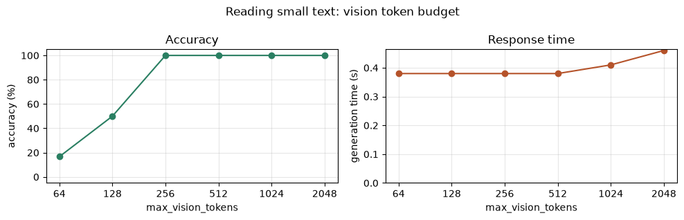
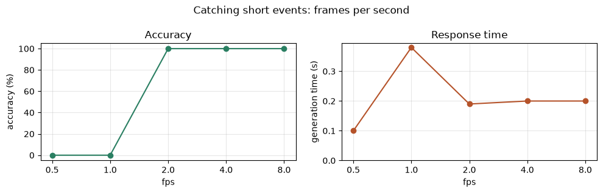

# Cosmos Reason 2 for First-Timers: The Settings That Change the Answer

A hands-on how-to for NVIDIA Cosmos Reason 2 (2B) on images and video, from your first call to a tuned setup. Every setting is measured for what it does to accuracy and response time.

[](https://colab.research.google.com/github/obiedeh/cosmos-reason2-first-timers-guide/blob/main/cosmos_reason2_first_timers_guide.ipynb)

## What one setting does

Two charts from the notebook, measured on `rtx-5090-workstation` on 2026-11-14.



Reading six small labels: the vision token budget takes the score from 1 of 6 to 6 of 6, at almost no cost in time.



Catching digits that flash on screen for half a second: below 2 frames per second the model never sees them.

## Why I built this

I use Cosmos Reason 2 in my own projects, including [Urban Edge Vision Analytics](https://github.com/obiedeh/urban-edge-vision-analytics), which watches live street cameras, and [Physical AI Safety Observability](https://github.com/obiedeh/physical-ai-safety-observability), a safety layer for robot workcells. In the safety project, one change to the request took false protective-gear alarms from 11 to zero on my labeled test frames. Settings like that are easy to miss, so I wrote the guide I would hand a developer new to the model.

See both projects running on a Jetson AGX Thor:

| Project | Video |
|---|---|
| Urban Edge Vision Analytics | [World Model vs YOLO: Cosmos Reason on Jetson AGX Thor](https://www.youtube.com/watch?v=PtIh9hnD8Lo) |
| Physical AI Safety Observability | [PPE Detection: NVIDIA Cosmos Reason 2 on Jetson AGX Thor](https://www.youtube.com/watch?v=bXhttNSlDP0) |

I built it for Google Colab on purpose, to make the model easier to learn and adopt. It runs in a browser with nothing to install on your own machine, so a first-timer can go from zero to a working call without owning a GPU.

**Moving to Cosmos 3?** [Cosmos 3 Edge for First-Timers](https://github.com/obiedeh/cosmos3-edge-first-timers-guide) runs the same tests on the Cosmos3-Edge reasoner and lists what carries over from this guide and what does not.

## The model, its sizes, and why the 2B

Cosmos Reason 2 is NVIDIA's vision language model for physical AI. You give it an image or a video and a question, and it answers in text.

- NVIDIA's code, samples and prompt templates: [github.com/nvidia-cosmos/cosmos-reason2](https://github.com/nvidia-cosmos/cosmos-reason2)
- NVIDIA's prompt guide: [Cosmos Cookbook](https://nvidia-cosmos.github.io/cosmos-cookbook/getting_started/prompt_guide/reason_guide.html)

NVIDIA publishes three sizes on Hugging Face:

| Model | Parameters | Built on | NVIDIA's stated minimum GPU memory |
|---|---|---|---|
| [Cosmos-Reason2-2B](https://huggingface.co/nvidia/Cosmos-Reason2-2B) | 2.4 billion | Qwen3-VL-2B | 24 GB |
| [Cosmos-Reason2-8B](https://huggingface.co/nvidia/Cosmos-Reason2-8B) | 8.8 billion | Qwen3-VL-8B | 32 GB |
| [Cosmos-Reason2-32B](https://huggingface.co/nvidia/Cosmos-Reason2-32B) | 33.4 billion | Qwen3-VL-32B | not listed |

The memory column is NVIDIA's figure from their README, not measured here.

Why this guide uses the 2B:

- **It fits the hardware a first-timer has.** In this notebook the 2B held 4.3 GB on the GPU and peaked at 6.0 GB, measured on `rtx-5090-workstation`. That is the size with the best chance on a Colab GPU.
- **It is the one I run.** Both of my projects above use the 2B on a Jetson AGX Thor.
- **The lessons carry over.** All three sizes share one architecture family and are called the same way, so the settings here apply to the larger models. Their scores will differ and are not measured in this guide.

What the 2B gives up, from my safety project on a Jetson AGX Thor: on the same 60 frames and the same output rules, the 2B reported six people on footage with no people, and the 8B reported none. The 8B generated about 13 tokens a second there against about 60 for the 2B. When the 2B is wrong at every setting, a larger size is the next thing to try.

## What it covers

| Part | Topic |
|---|---|
| 1 | Set up Colab, get model access, install, load the model, build the helpers |
| 2 | First image call and first video call |
| 3 | What is inside a call: messages, the prompt, tokens |
| 4 | `max_new_tokens`: output length and time |
| 5 | Vision token budget: image detail, accuracy and time. Cropping. |
| 6 | Video: `fps`, the shared frame budget, splitting a long video |
| 7 | Context window: counting what you send |
| 8 | Where the time goes: the first token against the rest |
| 9 | Reasoning mode: accuracy against time |
| 10 | Sampling: `temperature`, `top_p`, `top_k`, `repetition_penalty`, `seed` |
| 11 | Prompt structure: media order and the system prompt, tested |
| 12 | Knowing when it is wrong: leading questions and answer agreement |
| 13 | Real footage check: a warehouse camera |
| 14 | Task gallery: NVIDIA's prompts on NVIDIA's footage |
| 15 | Several images, and follow-up questions |
| 16 | Speed and memory: batching and 4-bit loading |
| 17 | Streaming, and the same parameters on a vLLM server |
| 18 | A template for tuning on your own data |
| 19 | Cheat sheet, troubleshooting and sources |

Each of Parts 2 to 18 runs on its own after Part 1.

## Run it

1. Create a free [Hugging Face](https://huggingface.co) account if you do not have one.
2. Open the [`nvidia/Cosmos-Reason2-2B`](https://huggingface.co/nvidia/Cosmos-Reason2-2B) model page and accept the license. The model is gated, so the download fails until you do.
3. Create a read token at [huggingface.co/settings/tokens](https://huggingface.co/settings/tokens).
4. Press the Colab button above and choose a GPU runtime. The free T4 GPU is enough.
5. In Colab, click the key icon in the left bar, add a secret named `HF_TOKEN` with your token, and switch on notebook access.
6. Run all.

Part 1 of the notebook walks through the same steps.

The notebook downloads about 50 MB of NVIDIA's sample footage from NVIDIA's own sites when it runs. None of that media is stored in this repository.

## Models, versions and hardware

| Item | Value |
|---|---|
| Model | `nvidia/Cosmos-Reason2-2B`, 16-bit weights, about 4.9 GB to download and 4.3 GB on the GPU |
| Library | `transformers==4.57.3`, the version NVIDIA's own sample pins |
| Measured on | `rtx-5090-workstation`, PyTorch 2.11.0 with CUDA 12.8, 2026-11-14 |
| Also run on | Google Colab, 2026-11-14, start to finish with no errors on both the free T4 GPU runtime and an A100 runtime. Both of those runs were on the version before the spelling change. The version with US spelling was then run on Colab to the end with no errors (2026-11-14). Outputs from those runs were not saved. Run again on 2026-11-18 on the free T4 runtime and on an A100 (40 GB) runtime: all 42 code cells with no errors on both. As on the workstation, one Part 9 question with reasoning on ran to its 800-token limit while thinking. The records, with every output: [T4](records/cosmos_reason2_first_timers_guide.executed.colab-t4.2026-11-18.ipynb), [A100](records/cosmos_reason2_first_timers_guide.executed.colab-a100.2026-11-18.ipynb). |
| Server tests (Part 17) | vLLM 0.33.0 on `rtx-5090-workstation`. Reference text in the notebook, not executed cells. |

## How it works

Every call goes through one helper, `ask()`, so each setting under study is one named argument. The helper builds the conversation, prepares the inputs, generates, then records token counts, seconds and peak GPU memory.

Accuracy is measured with tests that have a known answer:

- **Generated tests.** An image of six labeled boxes with printed codes, and a video that flashes digits in order. The right answer is known exactly, so a setting's effect shows up as a score.
- **NVIDIA's footage.** A warehouse camera clip and NVIDIA's task examples, with the answers checked by eye.

Two functions, `evaluate()` and `sweep()`, score any list of questions against any setting. Part 18 turns them into a template for your own cameras.

Video frames are read with OpenCV and passed to the processor with their timestamps. See the first entry in the issues log for the reason.

## Measured results

All figures below come from one run on `rtx-5090-workstation` on 2026-11-14. The record is [`records/cosmos_reason2_first_timers_guide.executed.rtx-5090-workstation.2026-11-14-run2.ipynb`](records/cosmos_reason2_first_timers_guide.executed.rtx-5090-workstation.2026-11-14-run2.ipynb), the same notebook with its outputs. The full run took 179 seconds.

An earlier run from the same day is kept beside it. Its test questions used British spelling ("colour"). The second run uses US spelling, and two results moved between the runs: batching went from 1.4x to 1.5x, and the lowest warehouse score went from 2 to 1 of 6.

| Change | Before | After |
|---|---|---|
| Vision token budget raised from 64 to 256 (reading six labels) | 1 of 6 | 6 of 6 |
| Image read as two halves at 128 tokens each, against the whole image at 128 | 2 of 6 | 6 of 6 |
| Video frame rate raised from 1 to 2 frames per second (digit clip) | wrong | right |
| Video frame budget raised from 256 to 512 tokens | wrong | right |
| 20-digit clip split into 8 clips at 512 tokens, against one call at 4096 | 40 digits returned | all 20, in order |
| Escape clause added to a leading question | invents a black coffee cup | says there is none |
| Batching several questions in one call | 1.30 s | 0.88 s (1.5x), 6.0 GB peak |
| 4-bit loading | 4.3 GB, 113 tokens a second | 1.7 GB, 80 tokens a second, 4 of 6 labels read at 256 vision tokens where 16-bit reads 6 |

Results that did not improve, kept because they are useful:

- **Reasoning mode** scored 2 of 5 against 1 of 5 direct, at about 440 output tokens against about 9. One answer was cut off.
- **Sampling.** Reading codes was 100% correct with greedy decoding, 93% at NVIDIA's defaults and 80% at temperature 1.3.
- **Media order and system prompt** made no clear difference: 9, 8, 9 and 9 of 12.
- **Too many clips hurts.** 12 clips double-counted digits cut at clip boundaries (22 returned for 20), and 8 clips at 128 tokens invented digits (77 returned).
- **Answer agreement works as a warning.** Where sampled answers agreed, 3 of 3 were right. Where they scattered, 0 of 5 were right.
- **Real warehouse footage** scored 1 to 3 of 6 across every frame rate and budget tried, and reasoning did not help. One error is specific to real scenes: the model says the second person wears a vest because a vest hangs on a post in the same frames.

## Issues found and their causes

Kept as found. Nothing here was cleaned up to make the work look smoother.

| Issue | Cause | What I changed |
|---|---|---|
| Passing a video path to the processor fails with a `torchcodec` error | The built-in video loader needs `torchcodec`, which is absent alongside torchvision 0.26 and later. Seen on transformers 4.57.3 and 5.x. | Frames are read with OpenCV and passed with `VideoMetadata` and `do_sample_frames=False` |
| Results shift slightly on transformers 5.x | 5.x wraps video in extra start and end tokens | Pinned `transformers==4.57.3`. The notebook also runs without errors on 5.20. |
| vLLM 0.33 rejects per-request `mm_processor_kwargs` with a 400 | Disabled by default in that version | Start the server with `--trust-request-mm-kwargs` |
| Per-request `fps` in `mm_processor_kwargs` has no effect on vLLM 0.33 | The frame rate is read from a different field | Send `media_io_kwargs={"video": {"fps": N}}` |
| Empty `content` from vLLM with `--reasoning-parser qwen3` | The parser puts a plain answer in `message.reasoning` | Send `chat_template_kwargs={"enable_thinking": False}` |
| First long-video split scored worse than one call | 4 clips at 512 tokens left too few tokens per frame | Rebuilt as a four-row comparison that shows the working split and both ways it fails |
| Grounding "the load on the forklift" returned unusable boxes | The phrase was too vague for the model | Name the object: "the pallet of water bottles" |
| The 4-bit model stayed in GPU memory after its section | A loop variable still held a reference | Delete both references before clearing the cache |
| Early drafts had text that did not match the measured output | Text written before the final run | Rewrote each passage from the record |

## What is not established

- **These are small tests.** Each accuracy test has 5 to 12 questions. They show an effect. They are not benchmarks.
- **Timings are from an RTX 5090.** Expect slower numbers on other GPUs.
- **Server notes apply to vLLM 0.33.0 only.** Older and newer versions were not tested.
- **The earlier record's text cells were updated after its run** (title and author notes). Its code cells and outputs are as measured.

## Editing the notebook

The cells live as plain text in `notebook_src.txt`. A line that is exactly `#%% md` or `#%% code` starts a new cell.

```bash
pip install -r requirements-dev.txt
python build_notebook.py     # rebuilds the notebook from notebook_src.txt
pytest                       # checks the notebook matches its source, and repository hygiene
```

## About

Obinna Edeh, Head of Physical AI Lab, [EmbodiedEdge](https://embodiededge.ai). I design and build Physical AI and edge AI systems, and prove them on real robots and hardware. I run Cosmos Reason 2 and Cosmos3-Edge on a Jetson AGX Thor.

- GitHub: [obiedeh](https://github.com/obiedeh)
- LinkedIn: [Obinna Edeh](https://www.linkedin.com/in/obinna-edeh-206306137/)

This is independent work. It is not affiliated with or endorsed by NVIDIA.

## License

Code and text are under the Apache License 2.0. See [LICENSE](LICENSE). The model and the sample footage belong to NVIDIA and carry their own licenses.

## Change log

See [CHANGELOG.md](CHANGELOG.md).
